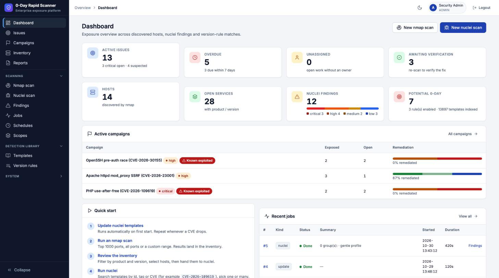
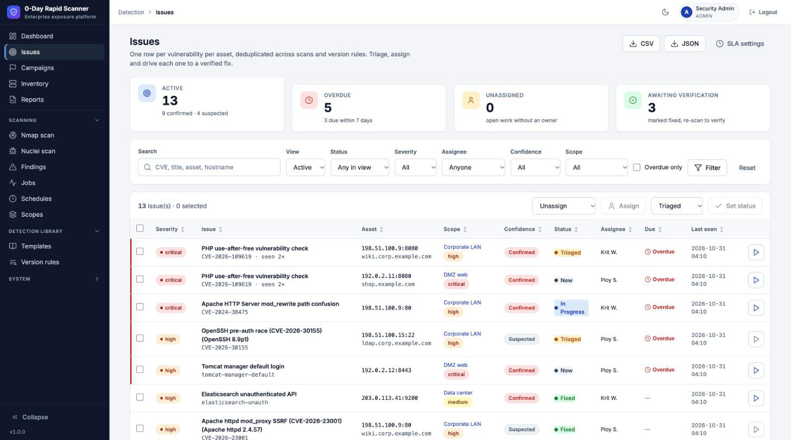
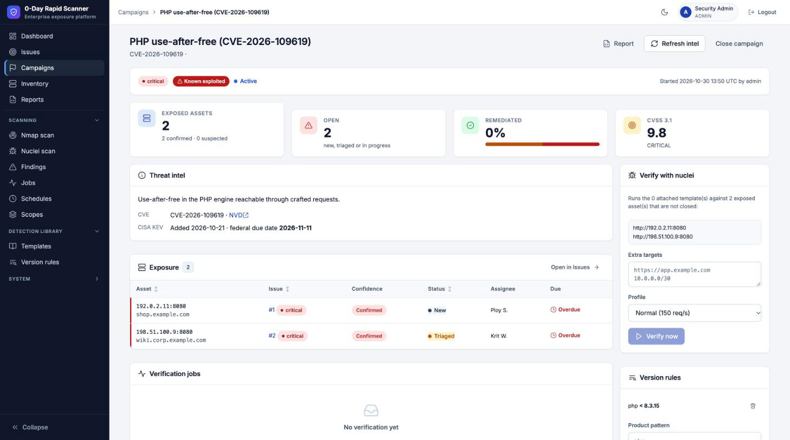
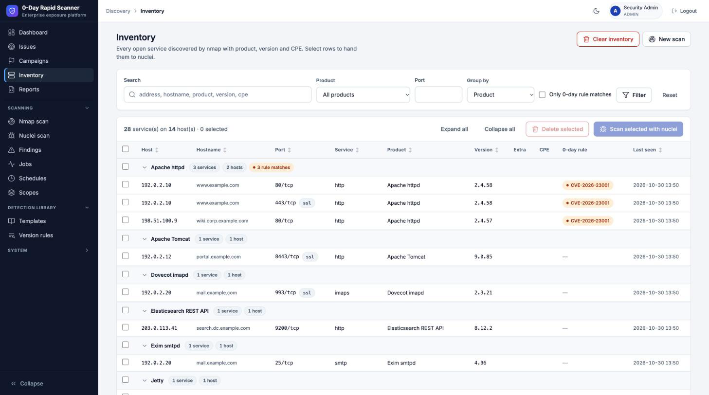
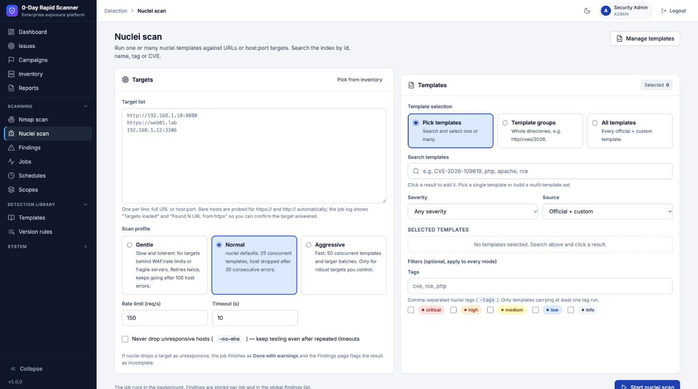

# 0-Day Rapid Scanner

[](CHANGELOG.md)
[](https://github.com/zildjiean/Vulnerabilty-Rapid-Scanner/actions/workflows/ci.yml)
[](LICENSE)
[](https://www.python.org/)
[](docker-compose.yml)

A small, self-hosted web console around **nmap** and **nuclei** for reacting to new vulnerabilities fast.
Scan a network, build a host / software / version inventory, run nuclei templates (official or your own
0-day templates) against selected hosts, and flag exposed versions with rules **before** a public template exists.

Everything runs in one container. No external services, no accounts, works offline inside a lab network.



## Features

- **Nmap discovery** from the browser: top 1000 ports, all 65 535 ports or a custom range; SYN or connect scan; live log.
- **Inventory** of every open service with product, version, CPE and hostname. Filter, sort, select, delete.
- **Attack-surface changes**: each nmap scan is compared with the last known inventory — new hosts, opened and
  closed ports, version changes and hosts that stopped responding — with acknowledge, a dashboard card and one
  `surface.changed` notification per scan.
  Group the table by host, product or service type (Web, Database, Remote access, Mail, File sharing,
  Directory & auth, Network services, Other); groups collapse and select as a unit.
- **Nuclei scanning** with three selection modes: pick templates (search by id, name, tag, CVE), whole template
  groups (`http/cves/2026`, `network`, …) or all templates, plus tag and severity filters.
- **Issues** that turn findings into work: one issue per vulnerability per asset, deduplicated across scans.
  Version-rule matches open *suspected* issues instantly; nuclei results open or confirm them. Lifecycle
  New → Triaged → In progress → Fixed → Fix verified (or False positive / Accepted risk with a reason), owners,
  SLA due dates (critical 3, high 7, medium 30, low 90 days by default), timeline and comments, bulk triage.
  Fixed issues reopen when seen again; suspected issues close themselves when a re-scan shows a patched version.
- **Findings** view across jobs with severity ordering and search; every finding links to its issue.
- **Scopes and schedules**: group assets by environment with an owner and a business criticality; new issues
  in a scope are assigned to its owner. Schedule nmap discovery and nuclei scans per scope (every N hours, daily
  or weekly in your timezone) and automatic re-verification of active campaigns.
- **Threat campaigns** for every new CVE: NVD details (CVSS, description, references) and CISA KEV status
  (known exploited, ransomware use, federal due date) pulled automatically; a version rule and the matching
  nuclei templates in the same form; live exposure, remediation progress and one-click **Verify** that scans only
  the exposed assets.
- **0-day watch**: every hour the scanner reads newly published or changed CVEs from NVD and new CISA KEV entries,
  matches their affected products and version ranges against the inventory (nmap CPE, a product alias table and
  name similarity; *confirmed* when the version is in range, *possible* when it cannot be checked) and prepares a
  **draft campaign** for each hit, with disabled version rules and any matching nuclei template, then notifies the
  team. A person reviews the draft and presses *Activate* (rules enabled, suspected issues opened) or *Dismiss*.
  Templates published later are attached automatically. Thresholds (minimum CVSS, always include KEV, include
  possible matches) and *Check now* are on the **0-day watch** page.
- **0-day response** without waiting for upstream:
  - upload custom nuclei templates or pull them from a raw URL (validated with `nuclei -validate`);
  - version-match rules (`php` + `< 8.3.15`) evaluated against the inventory after every scan, no traffic to targets.
- **Updates** for nuclei templates, the nuclei engine and the nmap script DB, each as a tracked job.
- **Jobs** with persisted logs, Server-Sent Events streaming, cancel, and automatic cleanup after restarts.
- **AI assistant (bring your own model)**: Anthropic Claude, OpenAI, Azure OpenAI, Google Gemini or any
  OpenAI-compatible server (Ollama, vLLM, LM Studio, OpenRouter, Groq …) with your own API key. It drafts campaigns
  from advisories, drafts detection-only nuclei templates (validated before you save), explains issues with
  remediation steps, triages scan evidence, turns plain-language questions into filters, writes report summaries and
  diagnoses failed scans. It only suggests: people decide. IPs and host names are replaced by `HOST-n` tokens before
  leaving the scanner (per-provider switch), keys are encrypted, and every call is audited with token usage.
- **Automatic re-verification**: when a confirmed issue is marked fixed, its template is re-run against the asset
  after a short delay; not found → fix verified, found → reopened, incomplete scan → stays fixed with a note.
- **One-click proof**: *Verify now* re-runs an issue's template against its asset and the Proof card shows the exact
  request/response nuclei matched on (plus a curl command to reproduce it by hand). Issues raised by a version rule
  can link or AI-draft a verification template first. A reproduced issue is marked **Verified** (confidence
  levels: Suspected → Confirmed → Verified) with a badge that links straight to its proof. **Verify selected** on the
  Issues list (and **Verify all with proof** on a campaign) verifies many issues at once, one nuclei job per template.
- **Reports**: printable executive summary (open exposure, overdue, MTTR, SLA compliance, weekly trend, riskiest
  assets, scopes, campaigns), campaign and scope reports with an **Evidence** appendix of verified issues' proof, a
  per-issue evidence report (**Print proof**: risk, intel, timeline, full request/response), all savable as PDF from the
  browser, and CSV / JSON issue exports.
- **REST API** (`/api/v1`) with hashed, role-scoped, expiring API keys: issues, assets, campaigns, scans and jobs.
  See *System → API → API reference* in the app.
- **Notifications and ticketing**: Slack, Microsoft Teams, email, signed webhooks, Jira and GitLab. Rules pick
  events (new / reopened / overdue / assigned issues, status changes, campaigns, failed scans, schedule errors),
  a minimum severity and a scope. Jira / GitLab tickets stay in sync both ways: closing the issue closes the
  ticket, closing the ticket marks the issue fixed for verification. Reliable outbox with retries and a delivery
  log; integration secrets are encrypted at rest.
- **Team access**: multiple users with **admin / analyst / viewer** roles, one-time temporary passwords, deactivation
  that ends sessions immediately, and a filterable, CSV-exportable **audit log** of every sign-in and change.
- **Security basics**: forced password change on first login, CSRF tokens, login rate limiting, HttpOnly session
  cookie, argv-only subprocesses with allow-list validated targets, non-root container.
- **Enterprise-grade UI**: compact sidebar (daily pages on top, collapsible Scanning / Detection library / System groups), light/dark theme, KPI cards, sortable tables, keyboard and
  screen-reader friendly, no third-party frontend assets.

| Issues | Threat campaign |
|---|---|
|  |  |
| **Inventory grouped by product** | **Nuclei scan** |
|  |  |
| **Verify now and Proof** | **Verification template for a suspected issue** |
|  |  |

<sub>Screenshots use fictional demo data (RFC 5737 documentation addresses, example.com hosts, made-up CVE ids).</sub>

## Quick start

> 🇹🇭 คู่มือภาษาไทย: [docs/USER_GUIDE.th.md](docs/USER_GUIDE.th.md)

```bash
git clone https://github.com/zildjiean/Vulnerabilty-Rapid-Scanner.git
cd Vulnerabilty-Rapid-Scanner
docker compose up -d --build
```

Open <http://localhost:8000> and sign in with **admin / changeme**. You must set a new password
(12+ characters) before anything else works. The first start downloads the official nuclei-templates into the
`/data` volume; watch it under *Jobs*.

## Workflow

Step-by-step user guide in Thai: **[docs/USER_GUIDE.th.md](docs/USER_GUIDE.th.md)** (คู่มือการใช้งานภาษาไทย).

0. **Scopes** – describe each environment once (targets, exclusions, owner, criticality) and add schedules:
   nightly discovery, weekly nuclei, re-verify campaigns every few hours.
1. **Nmap** – enter targets (IP, CIDR, range, hostname), choose the port range, start. SYN scans need
   `NET_RAW`/`NET_ADMIN` (granted in `docker-compose.yml`); pick *Connect* if raw sockets are unavailable.
2. **Inventory** – review hosts and services grouped by host, product or service type, filter by product or
   version, select rows or whole groups and hand them to nuclei.
3. **Nuclei** – pick templates, groups or everything, optionally narrow by tags / severity, start. Results land in *Findings*.
4. **0-day drops** – open *Campaigns → New campaign*, enter the CVE and the vulnerable versions. Exposed assets
   appear at once as suspected issues; press *Verify* to confirm them with nuclei. If no public template exists
   yet, upload or pull one under *Templates* and attach it to the campaign. The **0-day watch** prepares these
   campaigns as drafts on its own when a new CVE matches the inventory: review them under *Campaigns → Draft*.
5. **Issues** – triage what was found: assign an owner, move it through the lifecycle, watch the SLA, and
   re-scan to verify the fix.
6. **Proof** – press **Verify now** on an issue to re-run its template and capture proof before assigning the fix.
7. **Reports** – share the executive summary or a campaign report; export issues to CSV / JSON or pull them over
   the REST API.
8. **Updates** – refresh templates whenever needed. The nmap binary and the pinned nuclei version are updated by
   rebuilding the image: `docker compose build --pull --no-cache && docker compose up -d`.

## Users and roles

| Permission | Admin | Analyst | Viewer |
|---|:-:|:-:|:-:|
| Read every page, job log, finding and inventory row, reports and exports | ✓ | ✓ | ✓ |
| Create API keys (up to your own role) | ✓ | ✓ | ✓ |
| Start nmap / nuclei scans, cancel jobs | ✓ | ✓ | |
| Delete inventory services, clear the inventory | ✓ | ✓ | |
| Manage version rules and custom templates | ✓ | ✓ | |
| Triage issues (status, owner, severity, comments) | ✓ | ✓ | |
| Create and run campaigns (verify also needs scan rights) | ✓ | ✓ | |
| Use the AI assistant (results are readable by everyone) | ✓ | ✓ | |
| Manage scopes and schedules | ✓ | ✓ | |
| Update nmap, nuclei and the templates | ✓ | | |
| Manage users, integrations, AI providers, SLA / timezone / notification settings, read and export the audit log | ✓ | | |

Admins add users under *System → Users*. The scanner generates a temporary password that is shown once;
the user must replace it at first sign-in. Deactivating a user, resetting their password or changing their role
signs them out everywhere. You cannot deactivate, delete or demote yourself, and the last active admin is protected.
Users who existed before roles were introduced are upgraded to admin automatically.

Everything that changes state is written to *System → Audit log* (who, what, target, details, source IP),
including failed sign-ins and denied attempts. Filter by user, action group and date range, or export to CSV.

## Network access

Besides the targets, the scanner contacts GitHub (template and nuclei updates), `services.nvd.nist.gov` and
`www.cisa.gov` (campaign intel; the KEV feed is cached in `/data/kev.json` for 24 hours), `api.first.org` (EPSS
scores for the risk score, refreshed hourly for the CVEs on issues and campaigns; the 0-day watch also queries
NVD and the KEV feed hourly for new CVEs, sending only date ranges and CVE ids, never inventory data), and the integrations
you configure (Slack, Teams, SMTP, Jira, GitLab, webhooks) and the AI provider you add (with redaction on, scan
data leaves only as `HOST-n` placeholders; a local Ollama keeps everything on your network). Without internet
access campaigns still work: intel shows an error and can be refreshed later; risk scores fall back to severity,
confidence and scope criticality.

## Configuration

| Variable | Default | Purpose |
|---|---|---|
| `DATA_DIR` | `/data` | SQLite DB, custom templates, nuclei templates, secret key |
| `SECRET_KEY` | generated, stored in `/data/secret_key` | session cookie signing |
| `HTTPS` | `0` | set `1` behind TLS so the cookie gets the `Secure` flag |
| `NMAP_BIN` / `NUCLEI_BIN` | image paths | binaries |
| `NUCLEI_TEMPLATES_DIR` | `/data/nuclei-templates` | official templates |

Put the container behind a reverse proxy with TLS for anything beyond a local lab.

## Development

```bash
python3.12 -m venv .venv && source .venv/bin/activate
pip install -r requirements-dev.txt
pytest -q                                   # fake nmap/nuclei shell scripts, runs anywhere
DATA_DIR=./data uvicorn app.main:create_app --factory --reload
```

Project layout:

```
app/            FastAPI application (routers, scanners, parsers, templates, static)
tests/          pytest suite with fixtures for nmap XML, nuclei JSONL and templates
docs/           design spec, implementation plan, screenshots
Dockerfile      python:3.12-slim + nmap + nuclei, non-root user
```

See [CONTRIBUTING.md](CONTRIBUTING.md) for the development workflow and [SECURITY.md](SECURITY.md) for reporting
vulnerabilities.

## Responsible use

This tool sends packets to the targets you enter. **Only scan systems you own or are explicitly authorized to
test.** The authors accept no liability for misuse. See [LICENSE](LICENSE).

## Built with

[nmap](https://nmap.org) · [nuclei](https://github.com/projectdiscovery/nuclei) and
[nuclei-templates](https://github.com/projectdiscovery/nuclei-templates) · [FastAPI](https://fastapi.tiangolo.com) ·
[SQLAlchemy](https://www.sqlalchemy.org) · [Jinja2](https://jinja.palletsprojects.com)

## License

[MIT](LICENSE) © 2026 zildjiean. nmap and nuclei are distributed under their own licenses.
