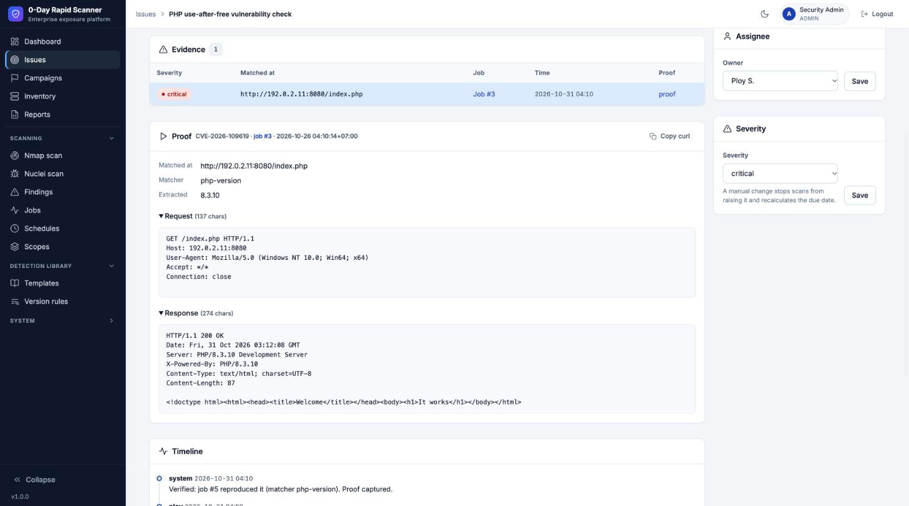
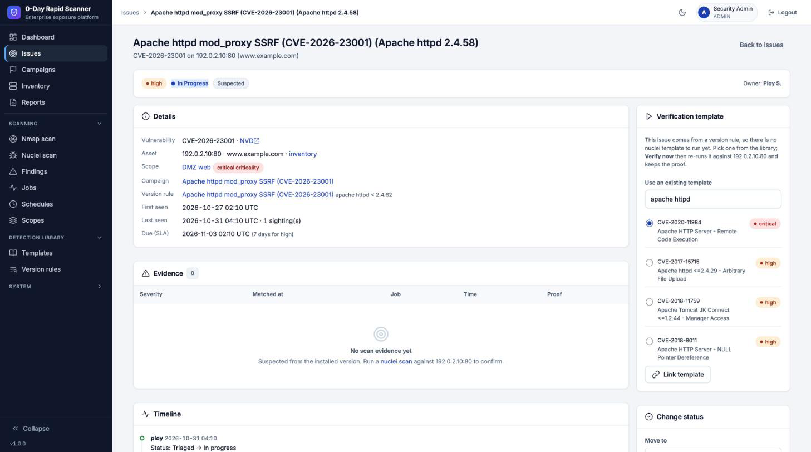

# คู่มือการใช้งาน 0-Day Rapid Scanner

คู่มือนี้อธิบายการใช้งานตั้งแต่ติดตั้งจนถึงรับมือ 0-day ตัวใหม่ เรียงตามเมนูด้านซ้ายของระบบ
(English overview: [README](../README.md))

คู่มือนี้ตรงกับ **เวอร์ชัน 1.1.0** ดูเวอร์ชันที่รันอยู่ได้ที่มุมล่างของเมนูด้านซ้าย (คลิกเพื่อเปิด
[CHANGELOG](../CHANGELOG.md)) หรือ `curl http://localhost:8000/healthz`

> **ใช้กับระบบที่คุณเป็นเจ้าของหรือได้รับอนุญาตให้ทดสอบเท่านั้น** เครื่องมือนี้ส่งแพ็กเก็ตไปยังเป้าหมายจริง

## สารบัญ

1. [ติดตั้งและเข้าสู่ระบบครั้งแรก](#1-ติดตั้งและเข้าสู่ระบบครั้งแรก)
2. [ภาพรวมเมนู](#2-ภาพรวมเมนู)
3. [ตั้งค่าเริ่มต้น (admin)](#3-ตั้งค่าเริ่มต้น-admin)
4. [ค้นหา asset: Nmap scan และ Inventory](#4-ค้นหา-asset-nmap-scan-และ-inventory)
5. [สแกนช่องโหว่: Nuclei scan และ Findings](#5-สแกนช่องโหว่-nuclei-scan-และ-findings)
6. [จัดการงาน: Issues](#6-จัดการงาน-issues)
7. [รับมือ 0-day: Campaigns, Templates, Version rules](#7-รับมือ-0-day-campaigns-templates-version-rules)
8. [สแกนอัตโนมัติ: Scopes และ Schedules](#8-สแกนอัตโนมัติ-scopes-และ-schedules)
9. [รายงานและ API](#9-รายงานและ-api)
10. [แจ้งเตือนและ Jira / GitLab](#10-แจ้งเตือนและ-jira--gitlab)
11. [AI assistant](#11-ai-assistant)
12. [ผู้ใช้ สิทธิ์ และ Audit log](#12-ผู้ใช้-สิทธิ์-และ-audit-log)
13. [อัปเดต nmap / nuclei / templates](#13-อัปเดต-nmap--nuclei--templates)
14. [แก้ปัญหาที่พบบ่อย](#14-แก้ปัญหาที่พบบ่อย)

---

## 1. ติดตั้งและเข้าสู่ระบบครั้งแรก

ต้องมี Docker และ Docker Compose

```bash
git clone https://github.com/zildjiean/Vulnerabilty-Rapid-Scanner.git
cd Vulnerabilty-Rapid-Scanner
docker compose up -d --build
```

1. เปิด <http://localhost:8000>
2. เข้าสู่ระบบด้วย **admin / changeme**
3. ระบบบังคับให้ตั้งรหัสผ่านใหม่ (อย่างน้อย 12 ตัวอักษร) ก่อนใช้งานส่วนอื่น
4. ครั้งแรกที่เปิด ระบบดาวน์โหลด nuclei-templates ทางการลง volume `/data` ดูความคืบหน้าได้ที่ **Scanning → Jobs**

ข้อมูลทั้งหมด (ฐานข้อมูล, template, คีย์เข้ารหัส) อยู่ใน volume `/data` สำรองข้อมูลด้วยการสำรอง volume นี้

ถ้าเปิดใช้งานนอกเครื่องตัวเอง ให้วางหลัง reverse proxy ที่มี TLS และตั้ง `HTTPS=1`

## 2. ภาพรวมเมนู

| ส่วน | เมนู | ใช้ทำอะไร |
|---|---|---|
| ส่วนบน (ใช้ทุกวัน) | Dashboard | ภาพรวม: issue ที่เปิดอยู่, เกิน SLA, campaign ที่ active, งานล่าสุด |
| | Issues | รายการช่องโหว่ต่อ asset ที่ต้องจัดการ |
| | Campaigns | ติดตาม CVE / 0-day แต่ละตัว |
| | Inventory | host, service, software, version ทั้งหมดที่เจอ |
| | Reports | รายงานผู้บริหาร, รายงาน campaign / scope, export |
| Scanning | Nmap scan, Nuclei scan | สั่งสแกนเอง |
| | Findings | ผลดิบจาก nuclei ทุก job |
| | Jobs | ประวัติงาน, log สด, ยกเลิกงาน |
| | Schedules, Scopes | สแกนตามเวลา และแบ่งกลุ่ม asset |
| Detection library | Templates | nuclei templates ทางการ + ของคุณเอง |
| | Version rules | กฎจับเวอร์ชันที่มีช่องโหว่ |
| System (พับไว้) | Updates, API, Users, Settings, Integrations, AI assistant, Audit log | ตั้งค่าและดูแลระบบ |

- คลิกชื่อกลุ่ม (Scanning, Detection library, System) เพื่อเปิดหรือปิด ระบบจำสถานะไว้
- ปุ่ม **Collapse** ด้านล่างย่อเมนูเหลือแต่ไอคอน
- ปุ่มพระอาทิตย์/พระจันทร์มุมขวาบนสลับธีมสว่าง/มืด
- เมนูที่ไม่มีสิทธิ์จะไม่แสดง (ดู[ข้อ 12](#12-ผู้ใช้-สิทธิ์-และ-audit-log))

## 3. ตั้งค่าเริ่มต้น (admin)

ทำครั้งเดียวหลังติดตั้ง ทุกข้อเลือกทำได้

1. **System → Settings**
   - **Timezone** (ค่าเริ่มต้น `Asia/Bangkok`) ใช้กับ schedule และการแสดงเวลา
   - **SLA** จำนวนวันที่ต้องแก้ตามความรุนแรง (ค่าเริ่มต้น critical 3, high 7, medium 30, low 90 วัน)
   - **SMTP** และ **Public URL of this scanner** ถ้าจะส่งอีเมลแจ้งเตือนที่มีลิงก์กลับมาที่ระบบ
2. **System → Users** เพิ่มทีมงาน (ดู[ข้อ 12](#12-ผู้ใช้-สิทธิ์-และ-audit-log))
3. **Scopes** แบ่ง asset ตามสภาพแวดล้อม (ดู[ข้อ 8](#8-สแกนอัตโนมัติ-scopes-และ-schedules))
4. **System → Integrations** ตั้งช่องทางแจ้งเตือน (ดู[ข้อ 10](#10-แจ้งเตือนและ-jira--gitlab))
5. **System → AI assistant** ถ้าต้องการให้ AI ช่วย (ดู[ข้อ 11](#11-ai-assistant))

## 4. ค้นหา asset: Nmap scan และ Inventory

### Nmap scan

1. ไปที่ **Scanning → Nmap scan**
2. **Targets** ใส่ IP, CIDR (`192.168.1.0/24`), ช่วง (`10.0.0.1-50`) หรือ hostname คั่นด้วยบรรทัดหรือช่องว่าง
3. **Port range**
   - *Top 1000* พอร์ตยอดนิยม เร็ว เหมาะกับการสำรวจครั้งแรก
   - *All 65535* ทุกพอร์ต ช้ากว่ามาก แต่ไม่พลาดบริการที่ซ่อนพอร์ตแปลก
   - *Custom* เช่น `22,80,443,8000-8100`
4. **Scan type**
   - *SYN (-sS)* เร็ว ต้องมีสิทธิ์ `NET_RAW` (ให้ไว้แล้วใน `docker-compose.yml`)
   - *Connect (-sT)* ใช้เมื่อ container ไม่มีสิทธิ์ raw socket
5. **Timing** T2 สุภาพ / T3 ปกติ / T4 เร็ว
6. กด Start ระบบพาไปหน้า job ที่แสดง log สด เสร็จแล้วผลเข้า Inventory อัตโนมัติ

### Inventory

- แสดงทุก service ที่เปิด: host, port, product, version, CPE, hostname
- **ค้นหา/กรอง** ตาม product, version, port ได้
- **Group by** เลือกจัดกลุ่มตาม *Host*, *Product* หรือ *Service type* (Web, Database, Remote access, Mail, File sharing, Directory & auth, Network services, Other) กลุ่มพับได้และเลือกทั้งกลุ่มได้
- **ส่งต่อให้ nuclei**: ติ๊กแถวหรือทั้งกลุ่ม แล้วกด **Scan selected with nuclei** เป้าหมายจะถูกกรอกให้
- **ลบ**: **Delete selected** หรือ **Clear inventory** (มีกล่องยืนยันก่อน)
- **Ask AI** (ถ้าตั้ง AI ไว้) พิมพ์คำถามภาษาคน เช่น "เครื่องที่รัน Apache เวอร์ชันเก่า" ระบบแปลงเป็นตัวกรองให้

## 5. สแกนช่องโหว่: Nuclei scan และ Findings

### Nuclei scan

1. ไปที่ **Scanning → Nuclei scan**
2. **Target list** มาจาก Inventory ที่เลือกไว้ หรือพิมพ์ URL / host:port เอง
3. **Template selection** มี 3 แบบ
   - *Pick templates* ค้นด้วย id, ชื่อ, tag หรือ CVE แล้วเลือกทีละตัวหรือหลายตัว
   - *Template groups* ทั้งโฟลเดอร์ เช่น `http/cves/2026`, `network`
   - *All templates* ทั้งหมด (ใช้เวลานาน)
4. **Source** *Official*, *Custom (0-day)* หรือ *Official + custom*
5. **Filters** (ไม่บังคับ ใช้กับทุกโหมด) tags และ severity เช่น เฉพาะ critical, high
6. **Scan profile**

   | Profile | ความเร็ว | เหมาะกับ |
   |---|---|---|
   | Gentle | 20 req/s, retry 2 ครั้ง | เป้าหมายหลัง WAF, rate limit, เซิร์ฟเวอร์เปราะบาง |
   | Normal | 150 req/s (ค่าเริ่มต้น nuclei) | ใช้ทั่วไป |
   | Aggressive | 400 req/s | เป้าหมายที่แข็งแรงและเป็นของคุณเอง |

   ปรับ **Rate limit** และ **Timeout** เองได้
7. กด Start ผลที่เจอเข้า **Findings** และสร้าง/ยืนยัน **Issue** อัตโนมัติ

### สถานะของ job

- **Done** เสร็จปกติ
- **Done with warnings** เสร็จแต่ผลอาจไม่ครบ เช่น host ไม่ตอบจน nuclei ข้าม หรือ error มาก หน้า job บอกเหตุผลและวิธีแก้ (ส่วนใหญ่คือเปลี่ยนเป็น profile *Gentle*)
- **Failed / Cancelled** ดู log ในหน้า job หรือกด **Diagnose** ให้ AI ช่วยวิเคราะห์

> สแกนแล้วไม่เจออะไรไม่ได้แปลว่าปลอดภัยเสมอ ให้ดูว่า job เป็น *Done with warnings* หรือไม่
> อยากลองดูผลจริงให้สแกนเว็บทดสอบที่อนุญาตไว้ เช่น `honey.scanme.sh`

### Findings

ผลดิบจาก nuclei ทุก job เรียงตามความรุนแรง ค้นหาได้ ทุกแถวลิงก์ไปยัง issue ที่เกี่ยวข้อง

## 6. จัดการงาน: Issues

Issue คือ "ช่องโหว่ 1 ตัว บน asset 1 ตัว" รวมผลจากหลาย scan ไม่ซ้ำกัน

**แหล่งที่มา**
- *Suspected* (สงสัย) จาก version rule ที่ตรงกับเวอร์ชันใน inventory ยังไม่ได้ยิงทดสอบจริง
- *Confirmed* (ยืนยันแล้ว) จาก nuclei ที่เจอจริง

**วงจรสถานะ**

```
New → Triaged → In progress → Fixed → Verified
                     ↘ False positive / Accepted risk (ต้องใส่เหตุผล)
```

**ทำงานกับ issue**
1. กรองตาม view, status, severity, assignee, confidence หรือ *Overdue only*
2. ติ๊กหลายแถวแล้ว **Assign** / **Set status** ทีเดียว
3. เปิด issue เพื่อดูหลักฐาน (request/response), timeline, ใส่ comment, เปลี่ยน owner หรือ severity
4. เมื่อแก้แล้วตั้งเป็น **Fixed** ระบบจะ **re-verify** อัตโนมัติด้วย template เดิม
   - ไม่เจอแล้ว → **Verified**
   - ยังเจอ → **Reopened**
   - สแกนไม่สมบูรณ์ → คงไว้ที่ Fixed พร้อมหมายเหตุ
5. issue ที่ปิดแล้วจะเปิดใหม่เองถ้าสแกนเจออีก และ issue *suspected* จะปิดเองเมื่อสแกนพบเวอร์ชันที่แก้แล้ว

**SLA**: วันครบกำหนดคิดจากความรุนแรง (ตั้งได้ที่ Settings) issue ที่เกินกำหนดแสดงเป็น *Overdue*

**ปุ่ม AI ในหน้า issue** (ถ้าตั้งไว้)
- **Explain & remediate** อธิบายและวิธีแก้ตาม product/version จริง กด **Add to timeline** เพื่อบันทึก
- **Triage evidence** ประเมินว่าหลักฐานน่าจะจริงหรือ false positive (เป็นคำแนะนำ ไม่เปลี่ยนสถานะเอง)

### ตรวจสอบซ้ำและเก็บหลักฐาน (Verify now / Proof)



- ปุ่ม **Verify now** (ไอคอน ▶) บนหน้า issue, ท้ายแถวในตาราง Issues และในตาราง Exposure ของ Campaign จะรัน nuclei
  ด้วย template ตัวเดิมต่อ asset นั้นตัวเดียว ผลขึ้นเป็นป้าย **reproduced** / **not reproduced** / **inconclusive**
  พร้อมบันทึกใน timeline ถ้า reproduced issue จะกลายเป็น confirmed
- การ์ด **Proof** แสดง HTTP request/response ที่ nuclei ใช้ match, matcher, ค่าที่ดึงได้ และปุ่ม **Copy curl**
  สำหรับยิงซ้ำด้วยมือ กด *proof* ที่แถวใน Evidence เพื่อดูของ job อื่น
- issue ที่มาจาก version rule ยังไม่มี template: การ์ด **Verification template** ให้ค้นหา template ที่มีอยู่แล้ว
  **Link template** หรือกด **Draft verification template with AI** → ตรวจ YAML → **Save & run as proof**
- ถ้าโมเดล AI ปฏิเสธ หน้าจอจะขึ้นข้อความภาษาอังกฤษแนะนำให้เปลี่ยน provider/model ที่ **System → AI**
  แล้วลองใหม่ (บางโมเดลไม่ยอมเขียน template ตรวจช่องโหว่แม้เป็นการทดสอบระบบของตัวเอง)
- ต้องมีสิทธิ์ `scan.run` จึงเห็นปุ่ม Play; viewer เห็น Proof ได้แต่สั่งสแกนไม่ได้



## 7. รับมือ 0-day: Campaigns, Templates, Version rules

นี่คือ flow หลักเมื่อมีช่องโหว่ใหม่ประกาศ

### ขั้นตอนเร็วที่สุด

1. **Campaigns → New campaign**
2. ใส่ **CVE id** ระบบดึงข้อมูลจาก **NVD** (CVSS, คำอธิบาย, references) และ **CISA KEV** (ถูกใช้โจมตีจริงหรือไม่, ransomware, due date) ให้อัตโนมัติ
3. ใส่ **Product pattern (regex)** และ **Vulnerable versions** เช่น `php` กับ `< 8.3.15` หรือ `>= 2.0, < 2.4.62`
   - ไม่แน่ใจ ให้วาง advisory ในช่อง *Advisory text* แล้วกด **Draft campaign with AI** ระบบเติมฟอร์มให้ตรวจ
4. บันทึก → asset ที่เข้าข่ายใน inventory ขึ้นเป็น **suspected issues ทันที** โดยไม่ต้องยิงอะไรไปที่เป้าหมาย
5. ถ้ามี nuclei template ของ CVE นี้ ผูกไว้กับ campaign แล้วกด **Verify** ระบบสแกนเฉพาะ asset ที่เข้าข่าย (เพิ่ม target เองได้) ผลที่เจอจริงยืนยันเป็น *confirmed*
6. ติดตามความคืบหน้าแก้ไขในหน้า campaign และออก campaign report

### ยังไม่มี template ทางการ?

ไปที่ **Detection library → Templates**
- **Upload & validate** ไฟล์ `.yaml` ของคุณ
- **Pull & validate** ดึงจาก raw URL (เช่น GitHub)
- **Draft template with AI** ให้ AI ร่าง template แบบตรวจจับอย่างเดียว แล้ว **Validate & save as custom template**

ทุก template ผ่าน `nuclei -validate` ก่อนบันทึก เลือกใช้ได้จาก Source *Custom (0-day)*

### Version rules

**Detection library → Version rules** คือกฎจับเวอร์ชันแบบเดียวกับใน campaign แต่ใช้งานแยกได้
ระบบตรวจกฎทุกข้อกับ inventory หลังทุก nmap scan

## 8. สแกนอัตโนมัติ: Scopes และ Schedules

### Scopes

**Scanning → Scopes → New scope**
- **Targets / Exclusions** ช่วง IP หรือ host ที่อยู่ใน scope และที่ต้องข้าม
- **Owner** issue ใหม่ใน scope นี้จะ assign ให้คนนี้อัตโนมัติ
- **Criticality** ความสำคัญทางธุรกิจ ใช้เรียงลำดับและในรายงาน

### Schedules

**Scanning → Schedules** หรือจากหน้า scope
- ชนิดงาน: **nmap discovery**, **nuclei scan** หรือ **campaign verify** (สแกนยืนยัน campaign ที่ active)
- ความถี่: ทุก N ชั่วโมง, รายวัน หรือรายสัปดาห์ ตาม timezone ใน Settings
- ตัวอย่างที่แนะนำ: discovery ทุกคืน, nuclei รายสัปดาห์, verify campaign ทุก 4–6 ชั่วโมง

## 9. รายงานและ API

### Reports

- **Executive summary** issue ที่เปิดอยู่, เกินกำหนด, MTTR, การทำตาม SLA, แนวโน้มรายสัปดาห์, asset เสี่ยงสุด, scope, campaign
  - กด **Write summary with AI** ให้ AI เขียนบทสรุปผู้บริหาร (ถ้าตั้งไว้)
- **Campaign report** และ **Scope report**
- พิมพ์หรือบันทึกเป็น PDF ด้วยปุ่ม **Print / Save as PDF**
- **Export** issue เป็น CSV / JSON ได้จากหน้า Issues

### REST API

1. **System → API** สร้าง API key: ตั้งชื่อ, role (ไม่เกิน role ของคุณ), วันหมดอายุ
2. key แสดงครั้งเดียว เก็บไว้ทันที
3. ส่ง key ใน header `Authorization: Bearer <key>` (หรือ `X-API-Key: <key>`) ไปที่ `/api/v1` มี endpoint สำหรับ issues, assets, campaigns, scans, jobs ดูตัวอย่าง curl ครบในหน้า **API reference** ในระบบ

   ```bash
   curl -s -H "Authorization: Bearer $ZDRS_KEY" http://localhost:8000/api/v1/me
   ```
4. กด **Revoke** เพื่อยกเลิก key

## 10. แจ้งเตือนและ Jira / GitLab

**System → Integrations** (admin)

1. **Add channel** เลือกชนิด: **Slack**, **Microsoft Teams**, **Email**, **Webhook** (มีลายเซ็น), **Jira**, **GitLab**
2. ตั้งกฎว่าจะส่งเมื่อไร: issue ใหม่ / เปิดใหม่ / เกินกำหนด / ถูก assign / เปลี่ยนสถานะ, campaign, scan ล้มเหลว, schedule error
   พร้อม severity ขั้นต่ำ และ scope
3. กด **Send test** เพื่อลองส่ง
4. **Jira / GitLab ซิงก์สองทาง**: ปิด issue ในระบบ → ปิด ticket, ปิด ticket → issue เป็น Fixed แล้วรอ re-verify
5. ดูประวัติการส่งและ retry ได้ที่ delivery log (ส่งไม่สำเร็จ retry อัตโนมัติ 1, 5, 15, 60 นาที)

secret ของ integration เข้ารหัสในฐานข้อมูล และไม่แสดงกลับมาหลังบันทึก

## 11. AI assistant

### ตั้งค่า (admin)

**System → AI assistant → Add provider**

| Provider | ต้องใส่ |
|---|---|
| Anthropic Claude | API key, model (ค่าเริ่มต้น `claude-opus-5-5`) |
| OpenAI | API key, model |
| Azure OpenAI | endpoint, deployment (model), API version, API key |
| Google Gemini | API key, model |
| OpenAI-compatible (Ollama, vLLM, LM Studio, OpenRouter, Groq …) | Base URL, model, API key (ถ้ามี) |

ตัวอย่าง Ollama บนเครื่องเดียวกับ Docker: Base URL `http://host.docker.internal:11434/v1`

จากนั้นกด **Test** แล้ว **Make default**

**แก้ค่าที่ใส่ผิด**: กด **Edit** ที่แถวของ provider แก้ได้ทุกช่อง รวมถึงประเภท provider (เช่น เลือก OpenAI ไว้แต่จริงๆ
เป็น Ollama ให้เปลี่ยนเป็น OpenAI-compatible) แล้วกด **Save & test** เพื่อบันทึกและทดสอบทันที
- ช่อง API key เว้นว่างไว้ = ใช้ key เดิม, พิมพ์ใหม่ = แทนที่, ติ๊ก **Remove stored key** = ลบ key (สำหรับ server
  ในเครื่องที่ไม่ใช้ key)
- เปลี่ยนประเภทแล้วไม่ได้ใส่ key ใหม่ ระบบเก็บ key เดิมไว้และเตือนให้ลบถ้า provider ใหม่ไม่ใช้
- แก้ประเภท, model, Base URL, API version หรือ key แล้วผล Test เดิมถูกล้าง ต้องทดสอบใหม่

- **Redact IPs and host names** (เปิดเป็นค่าเริ่มต้น): IP และ hostname ถูกแทนด้วย `HOST-1`, `HOST-2` ก่อนส่งออก และแปลงกลับตอนแสดงผล ปิดได้สำหรับ model ที่รันภายใน
- **Max output tokens** จำกัดความยาวคำตอบ
- หน้าเดียวกันแสดงการใช้ token ย้อนหลัง 30 วัน แยกตาม provider, ฟีเจอร์ และผู้ใช้

### จุดที่ AI ช่วย

| ที่ไหน | ปุ่ม | ได้อะไร |
|---|---|---|
| Campaigns → New campaign | Draft campaign with AI | เติม pattern, ช่วงเวอร์ชัน, severity, สรุป จาก advisory หรือ CVE |
| Templates | Draft template with AI | ร่าง nuclei template แบบตรวจจับอย่างเดียว ผ่าน validate ก่อนให้บันทึก |
| หน้า issue | Explain & remediate | อธิบายและวิธีแก้ เพิ่มลง timeline ได้ |
| หน้า issue | Triage evidence | ความเห็นว่าหลักฐานจริงหรือหลอก พร้อมสิ่งที่ควรเช็ก |
| Issues / Inventory | Ask AI | แปลงคำถามภาษาคนเป็นตัวกรอง |
| Reports | Write summary with AI | บทสรุปผู้บริหาร |
| หน้า job | Diagnose | วิเคราะห์ว่าทำไม scan ล้มเหลว / มี warning |

AI **แนะนำเท่านั้น** ไม่เปลี่ยนสถานะ ไม่สั่งสแกน ไม่บันทึก template เอง ใช้ได้เฉพาะ analyst และ admin

## 12. ผู้ใช้ สิทธิ์ และ Audit log

### Roles

| สิทธิ์ | Admin | Analyst | Viewer |
|---|:-:|:-:|:-:|
| ดูทุกหน้า, log, รายงาน, export | ✓ | ✓ | ✓ |
| สร้าง API key (ไม่เกิน role ตัวเอง) | ✓ | ✓ | ✓ |
| สั่งสแกน / ยกเลิก job | ✓ | ✓ | |
| ลบ inventory, จัดการ rules และ templates | ✓ | ✓ | |
| จัดการ issue, campaign, scope, schedule | ✓ | ✓ | |
| ใช้ AI assistant | ✓ | ✓ | |
| อัปเดตเครื่องมือ, จัดการผู้ใช้, integrations, AI providers, settings, audit log | ✓ | | |

### เพิ่มผู้ใช้

1. **System → Users → New user** ใส่ username, ชื่อ, role
2. ระบบสร้าง **รหัสผ่านชั่วคราวแสดงครั้งเดียว** ส่งให้ผู้ใช้ทางช่องทางที่ปลอดภัย
3. ผู้ใช้ต้องเปลี่ยนรหัสผ่านตอนเข้าครั้งแรก

การปิดบัญชี, reset รหัสผ่าน หรือเปลี่ยน role ทำให้ผู้ใช้นั้นถูก logout ทุกที่ทันที
คุณลบหรือลดสิทธิ์ตัวเองไม่ได้ และ admin คนสุดท้ายถูกป้องกันไว้

ผู้ใช้ทุกคนเปลี่ยนชื่อและรหัสผ่านของตัวเองได้ที่ปุ่มชื่อมุมขวาบน (Profile)

### Audit log

**System → Audit log** บันทึกทุกการเปลี่ยนแปลง: ใคร ทำอะไร กับอะไร จาก IP ไหน รวมถึง login ล้มเหลวและการถูกปฏิเสธสิทธิ์
กรองตามผู้ใช้, กลุ่ม action, ช่วงวันที่ และ export CSV ได้

## 13. อัปเดต nmap / nuclei / templates

**System → Updates** (admin) กดปุ่มอัปเดตแต่ละตัว ทำงานเป็น job ดู log ได้
- **nuclei templates** ควรอัปเดตทุกวันหรือทันทีที่มี 0-day ใหม่
- **nuclei engine** และ **nmap script DB**

อัปเดต binary nmap และเวอร์ชัน nuclei ที่ตรึงไว้ใน image ด้วยการ build ใหม่:

```bash
git pull
docker compose build --pull --no-cache && docker compose up -d
```

ข้อมูลใน `/data` ไม่หาย ตาราง/คอลัมน์ใหม่ของเวอร์ชันใหม่ถูกเพิ่มให้อัตโนมัติตอนเริ่มระบบ
ก่อนอัปเกรดควรสำรองฐานข้อมูล:

```bash
docker exec zero-day-rapid-scanner python -c "import sqlite3; s=sqlite3.connect('/data/scanner.db'); d=sqlite3.connect('/data/scanner.db.bak'); s.backup(d)"
```

เช็กเวอร์ชันหลังอัปเกรด: `curl http://localhost:8000/healthz` จะได้ `{"status":"ok","version":"1.1.0"}`

## 14. แก้ปัญหาที่พบบ่อย

| อาการ | สาเหตุ / วิธีแก้ |
|---|---|
| Nmap SYN scan error เรื่องสิทธิ์ | container ไม่มี `NET_RAW` ให้เลือก *Connect (-sT)* หรือเช็ก `cap_add` ใน `docker-compose.yml` |
| Nuclei เสร็จแต่ไม่มี finding | ดูว่าเป็น *Done with warnings* หรือไม่ ถ้า host "unresponsive" ให้ใช้ profile *Gentle*; เช็กว่า target มี `http(s)://` และ port ถูกต้อง; template ที่เลือกอาจไม่ตรงกับ service |
| Done with warnings | error มากหรือ host ถูกข้าม เปิดหน้า job อ่านเหตุผล หรือกด **Diagnose** |
| Campaign ไม่ขึ้นข้อมูล NVD / KEV | เครื่องออก internet ไม่ได้ ระบบยังใช้งานได้ กด refresh ทีหลัง |
| ไม่เห็นเมนู System บางรายการ | role ของคุณไม่ใช่ admin |
| AI ตอบ error 401 | API key ผิดหรือหมดอายุ แก้ที่ System → AI assistant แล้วกด Test |
| ลืมรหัสผ่าน admin | ให้ admin คนอื่น reset ที่ System → Users |

ดู log ของ container: `docker compose logs -f`
